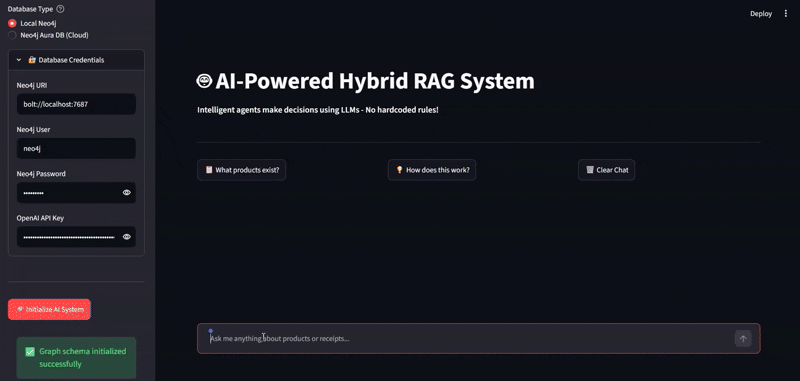

# AI-Powered Hybrid RAG System

A hybrid Retrieval-Augmented Generation (RAG) system that combines **Graph RAG** (Neo4j) and **Vector RAG** (ChromaDB + PDF embeddings) orchestrated by **CrewAI agents**. Built with a Streamlit UI and powered by GPT-4o.



## Architecture

```
User Query
    │
    ▼
┌─────────────────────────────────────────────────────┐
│                   CrewAI Agents                     │
│                                                     │
│  1. Query Analyst    → Understands intent & context │
│  2. Graph Expert     → Writes & runs Cypher queries │
│  3. Vector Expert    → Searches PDF receipts        │
│  4. Coordinator      → Synthesizes final response   │
└────────────┬──────────────────┬────────────────────┘
             │                  │
             ▼                  ▼
      Neo4j Graph DB       ChromaDB Vector Store
   (Products, Specs,      (PDF Receipts, Invoices,
    Manufacturers)         Warranty Documents)
```

### Agent Roles

| Agent | Role |
|---|---|
| Query Analysis Specialist | Classifies query intent, detects follow-up references, identifies products |
| Graph Database Expert | Generates Cypher queries for product lookups and listings |
| Document Search Specialist | Performs semantic search on PDF receipt documents |
| Response Coordinator | Merges all retrieved data into a coherent natural-language response |

---

## Features

- **Hybrid retrieval** — graph-structured product data + unstructured PDF receipts
- **Agentic pipeline** — no hardcoded routing rules; LLMs decide what to retrieve
- **Conversation memory** — retains last 5 exchanges for follow-up query resolution
- **On-the-fly PDF loading** — receipts are embedded at query time, not pre-loaded
- **Receipt viewer** — preview and download PDF receipts directly from the UI
- **Debug mode** — inspect agent reasoning, Cypher queries, and retrieved data

---

## Prerequisites

- Python 3.12+
- Neo4j (local) or Neo4j AuraDB (cloud)
- OpenAI API key

### Neo4j APOC setup (required)

The system uses `apoc.meta.data()` via `langchain_community`. Add the following to `neo4j.conf`:

```
dbms.security.procedures.unrestricted=apoc.*
dbms.security.procedures.allowlist=apoc.*
```

Restart Neo4j after saving.

---

## Installation

```bash
# Clone the repo
git clone <repo-url>
cd hybrid-rag

# Create and activate virtual environment
python -m venv venv
venv\Scripts\activate       # Windows
source venv/bin/activate    # macOS/Linux

# Install dependencies
pip install -r requirements.txt
```

---

## Configuration

Create a `.env` file in the project root:

```env
OPENAI_API_KEY=your_openai_api_key_here
```

---

## Usage

### 1. Generate synthetic data

```bash
python data_generator.py
```

This creates `products.json` and PDF receipts under `synthetic_data/`.

### 2. Import data into Neo4j + ChromaDB

```bash
cd synthetic_data
python import_data.py \
  --neo4j-uri neo4j://127.0.0.1:7687 \
  --neo4j-user neo4j \
  --neo4j-password your_password \
  --openai-key your_openai_key
```

### 3. Run the Streamlit app

```bash
streamlit run app.py
```

Open `http://localhost:8501` in your browser.

### 4. Initialize the system

In the sidebar:
1. Select database type (Local Neo4j or AuraDB)
2. Enter credentials
3. Click **Initialize AI System**

---

## Example Queries

### Graph only (product data from Neo4j)
```
What products are available?
List the top 10 product names.
Which products are in the Electronics category?
What is the price of the Wireless Earbuds Pro?
Who manufactures the Laptop Elite?
```

### Vector only (receipt/invoice data from PDFs)
```
What is the warranty period for the Yoga Mat?
What payment method was used for the T-Shirt Ultra?
Show me the invoice ID for order P1010.
What is the serial number on my Laptop Plus receipt?
```

### Hybrid (both sources)
```
What is the price and warranty period of the Laptop Elite?
Show me the specs and invoice ID for the Wireless Earbuds Pro.
What did I pay for the Yoga Mat, and what's the return policy?
Give me the full details of the Smartphone Plus including the receipt.
```

### Follow-up queries (uses conversation memory)
```
What about its warranty?
Show me the invoice for that.
What's the serial number?
How much did I pay for it?
```

---

## Project Structure

```
hybrid-rag/
├── app.py                  # Main Streamlit app + HybridRAGSystem class
├── data_generator.py       # Synthetic product + PDF receipt generator
├── main.py                 # CLI entry point
├── requirements.txt        # Python dependencies
├── pyproject.toml          # Project metadata
├── .env                    # Environment variables (not committed)
├── synthetic_data/
│   ├── import_data.py      # Bulk data import script
│   ├── products.json       # Generated product catalog
│   └── receipts/           # Generated PDF receipts
└── chroma_db/              # ChromaDB persistence (auto-created)
```

---

## Tech Stack

| Component | Technology |
|---|---|
| LLM | OpenAI GPT-4o |
| Agent Orchestration | CrewAI |
| Graph Database | Neo4j |
| Vector Store | ChromaDB |
| Embeddings | OpenAI Embeddings |
| PDF Parsing | LangChain + PyPDF |
| UI | Streamlit |
| Graph Interface | LangChain Neo4j |
